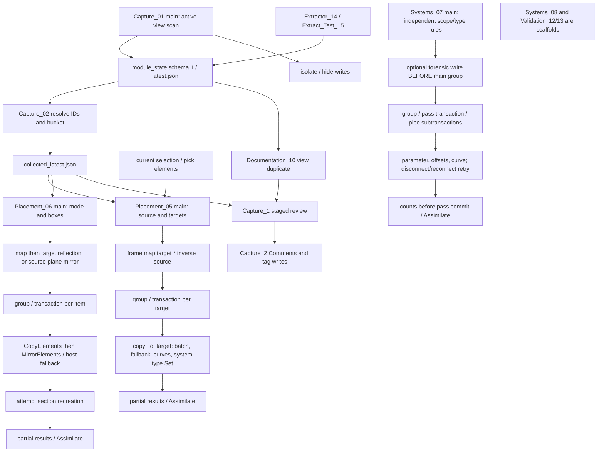

# M1.0 GC01 mirror diagnostic audit

Date: 2026-10-11. Status: **M1_0_AUDIT_COMPLETE**, documentation only. No Revit command, transaction, regeneration, geometry edit, connector operation or model save was executed. M1.1 is proposed, not started.

## Baseline and evidence boundaries

- Branch `main`, clean worktree/index at entry, HEAD `97d269ab009cea71528f4532bc1788874f7139ed`; live GitHub main advertised the same SHA. Origin is `https://github.com/BIM3DNA/PLEGTVOS_ModuleEngine.git`.
- M0.2 rebased documentation commit `72b68e8a` onto `f56f0ff`, producing `97d269ab`; the approved normal push completed. All eight remote commits and both extractor scripts are now local. Extension content remains identical to extraction baseline `f56f0ff`.
- M0.2 verified backup branch `backup/pre-m0-rebase-72b68e8` and complete bundle at `C:\Users\Korisnik\AppData\Local\Temp\PLEGTVOS-M0.2-250c605f13bd4c159532f972b509a44d\pre-m0-rebase.bundle`. These are prior-session backup results, not new host acceptance.
- Reviewed AGENTS, PROJECT_STATE, README, M0_AUDIT and MILESTONES. Their old M0 references to absent local extractors and an eight-commit gap are historical. This audit describes the recovered local baseline; it does not rewrite historical reports.
- `P` below expands to `PLEGTVOS_ModuleEngine.extension/PLEGTVOS_ModuleEngine.tab/Dev.panel/`. All script line references are at `97d269ab`. References such as **M:1166** mean the mirror script identified below, not an inferred module filename.
- Installed `C:\Program Files\Autodesk\Revit 2025\RevitAPI.xml` was read as the primary API contract. No Revit API code was executed. Static findings establish code paths/API mismatches, not that a particular GC01 model took those paths.
- GC01/02/04/06/07/08 extraction success remains user-reported historical host evidence. GC12 was reported visually successful in the M0.1 brief. No new extraction, mirror or slope acceptance occurred here. The original reports/fixtures/element IDs are still unavailable in supplied inputs.

## Architecture inventory

The three named engines are button titles, not reusable engine modules. They do not call one another. There is no mirror-to-slope-to-fitting-repair orchestration.

| Key / actual path under P | Entry, inputs, outputs and dependencies | API / transaction / failure behavior | Status |
| --- | --- | --- | --- |
| C1: `Capture_01.pushbutton/script.py` | `main:261`; active view, scope box or detail-line polygon; `module_state` writes latest/timestamped region IDs and view context | FilteredElementCollector scoped to active view, bbox-center XY inclusion; selection/isolation. `try_temp_isolate:159–192` attempts isolation without transaction, then transactions for isolate/hide fallback, without explicit rollback cleanup in exception paths | Implemented prototype; **not read-only**; does not close a MEP dependency graph |
| C2: `Capture_02.pushbutton/script.py` | `main:158`; latest.json to existing/missing IDs, category and pipeline buckets, collected_latest.json | GetElement; title mismatch stops, path mismatch only warns (`56–73`); no model transaction, filesystem writes | Implemented state consumer; no UniqueId/revision binding |
| T: `Placement_05.pushbutton/script.py` (transform_engine) | `main:549`; source and multiple target scope boxes, selected elements or collected JSON; copy counts and mapping pairs | Frame map `210–213`; CopyElements and curve recreation; one transaction per target under TransactionGroup (`587–649`). Local catches allow skipped items/targets; Commit status not checked before counters; group assimilates partial success | Implemented experimental copy/placement; no mirror and no connectivity acceptance |
| M: `Placement_06.pushbutton/script.py` (mirror_handler) | `main:859`; mode, copy flag, source/optional target box, collected JSON; created IDs/category failures, attempted section recreation | Group/assembly expansion, copy/map/mirror or mirror-in-place; one transaction per item under TransactionGroup (`1052–1279`); non-warning failure preprocessor requests local rollback; per-item errors continue; group assimilates partial result | Implemented experimental mirror; no network-wide success gate |
| S: `Systems_07.pushbutton/script.py` (slope_solver) | `main:1262`; scope box, include-all-elevations choice, hard-coded pipe type `926396`, VWA .0075/HWA .005 rules; console/UI summaries, optional temporary view | Parameter/offset/LocationCurve edits, DisconnectFrom/ConnectTo retry. Optional forensic write transaction before main group; main group has up to five pass transactions and per-pipe subtransactions (`1681–1949`). Counts are computed before pass commit; failed reconnection need not roll back | Implemented write tool, **not a read-only forensic button** |
| ST: `module_state.py` | Imported by capture/placement/extraction; schema 1 document/Revit metadata; timestamped/latest JSON | No model transactions. Candidate directories include model/central folder and title-based AppData fallback (`42–73`); writable-path probe creates/deletes file (`76–111`); first existing latest wins (`229–236`) | Implemented storage, no atomic write/locking or durable source identity enforcement |
| `Capture_1/script.py` | `main:368`; collected/view-duplicator state to Windows Forms review and review_latest.json | GetElement/parameter reads; no Revit transaction; persisted proposed codes/tag decisions | Implemented staging, plain directory, not discovered as pushbutton |
| `Capture_2/script.py` | `main:237`; review/view/region state to Comments, text, pipe/fitting tag attempts and result JSON | Parameter.Set, TextNote/IndependentTag.Create; one transaction `268–379`; catches individual failures and commits partial results; no outer explicit rollback guard | Implemented apply prototype, plain directory |
| `Documentation_10/script.py` | `main:88`; latest region/source FloorPlan to duplicated/cropped plan and JSON | View.Duplicate, template clearing/CropBox, one transaction with rollback on exception; writes output JSON after commit; injects XYZ helpers into module_state | Implemented, plain directory; not part of mirror execution |
| `Documentation_09/script.py` | `main` near 1720; boundary/editor, codes/tags, optional sheet/view/schedules | Earlier editor/code transactions precede sheet TransactionGroup; no call from mirror/transform | Implemented experimental documentation in plain directory; unchanged and not re-audited as a Sheet Generator project here |
| `State_04/script.py`, `Systems_08/script.py`, `Validation_12/script.py`, `Validation_13/script.py` | Titles state_serializer, fitting_rebuilder, preflight, postflight; imports/document setup only | No implemented workflow, fitting creation or validation gate | Scaffolds in plain directories |
| `UI_11/` | main_window.xaml and module_manager.xaml, no Python entry | No engine orchestration | UI assets only |
| `Module_Extractor_14.pushbutton/script.py` | Scope-box classifier/readiness to JSON; module_state dependency | Report-only model reads, filesystem output; no transaction | Recovered extraction baseline, unchanged; not the proposed connector diagnostic |
| `Module_Extract_Test_15.pushbutton/script.py` | Saved local source RVT to detached copied output plus reopened classification report | Writes only copied document in intended flow; SaveAs/reopen verification | Recovered validated prototype, unchanged and not invoked |

Seven current `.pushbutton` directories: Capture_01, Capture_02, Placement_05, Placement_06, Systems_07 and the two extractors. Nine other feature directories lack `.pushbutton`. Shared code is module_state; no independent transform_engine.py, mirror_handler.py or slope_solver.py exists. There is no general MEP system reconstruction: T:507–533 copies selected system-type parameter IDs best-effort; S only retries old connector pairs. Systems_08 contains no repair logic.

### Call graph and transaction boundaries



This graph describes existing code only. No arrow from mirror to slope/repair exists. A single Undo item produced by Assimilate does not mean failed child operations caused all earlier writes to roll back.

## Expected GC01 L-to-R transformation

Meeting-confirmed requirements (from the supplied October 11 brief, not an available transcript): finish GC01 L/R reliability; investigate fittings/connectivity/slopes; establish L/R drawing identity; preserve architectural project coordinates. Exact plane, anchors, tolerance, family behavior, drainage rules and naming remain engineering proposals requiring Alen/Emir review.

### Coordinate contract proposed for review

Use internal model coordinates for calculations. Record shared/project coordinate transforms and architectural reference points separately; do not acquire/publish coordinates, change project locations, move base points or translate the architecture.

Let `Ts` and `Tt` be **approved** orthonormal source/target frames with origins at declared anchors. Rigid mapping is `A = Tt * inverse(Ts)`. For a plane through `q` with unit normal `n`, reflection of a point is `H(x) = x - 2*n*dot(n, x-q)` and of a direction is `Hv(v) = v - 2*n*dot(n,v)`. The proposed target point is `H(A(p))`; its linear direction map is `(I - 2*n*n^T) * R_A`. For an approved center-plane, this is equivalently `Tt * diag(-1,1,1,1) * inverse(Ts)`. Reflection has determinant -1, so it cannot be represented by merely changing one rotation angle in a right-handed family frame.

Current M:893–958 constructs A from element bounding-box centers/bases, then selects the target center/left/right plane. For target half-width h, reflecting its mapped center about the right face moves the center to `target_center + 2*h*axisX`; left face moves it by `-2*h*axisX`. Thus face mode produces an adjacent module, not a center-contained target. That is a mathematical consequence of current code, **not a confirmed incorrect business rule**. The team must approve whether R occupies the selected box or sits outside its face. Current target selection also forces copy mode; Escape at target pick selects the no-target path, not full cancellation (M:879–891).

Installed Revit API documentation for `Element.BoundingBox(View)` states that returned boxes align with model axes. Their bases do not establish a rotated scope box's local design axes. T additionally swaps axes by bounding-box extents (T:178–198), while M uses BasisX directly. Current center-distance preflight validates construction of A, not the intended mirrored anchor, angular orientation or final location. Future diagnostics must record scope geometry and independently approved reference axes, reporting unconfirmed axes rather than guessing from an AABB.

For a vertical plane (`n.Z=0`) and a rigid map preserving vertical direction, reflection preserves endpoint Z and horizontal run, hence slope magnitude. A target elevation translation changes both endpoints equally. This does not prove correct drainage direction: compare mapped upstream/downstream roles, not just endpoint array order. Tilted/nonvertical frames, unsupported curves or unknown flow direction must be marked unresolved; do not automatically invoke slope_solver after mirror.

| Requirement area | Proposed acceptance / current gap | Team confirmation |
| --- | --- | --- |
| Plane and frames | Named anchors, unit axes, reflection mode and composed transform; compare final mapped points, not only centers | Left/right viewing convention; center versus adjacent face; source/target height |
| Element locations/rotations | Transform point, curve and orientation data; match expected correspondence without integer-ID reuse | Position/angular tolerances and allowed exceptions |
| Pipes/ducts | Preserve curve type/length/diameter/profile and mapped endpoints; unsupported flexible/curved cases explicit | Which curve categories are in GC01 scope |
| Fittings | Complete expected fittings inventory; transformed connector geometry and compatible angle/size/part type | Accepted elbow/reducer/eccentric orientation and material-specific families |
| Connectors | Physical-edge graph correspondence, domain/shape/size and directional compatibility; logical refs separate | Legitimate open boundary ports, exact domain-specific orientation rules |
| Mechanical equipment | Preserve equipment/type, placement, hosts, connector ports and system role | Equipment requiring distinct R family/type or non-mirrorable exception |
| Families and handedness | Record Mirrored, HandFlipped, FacingFlipped, transforms/orientations and host; compare approved behavior, not a universal flip flag | Family-specific L/R behavior and nested visibility switches |
| MEP systems | Record instance/type/classification and connector membership; target network functional and independent where intended | Preserve type versus create separate system identity/name; permitted source-target boundary connection |
| Slopes/flow | Compare signed elevation change along approved upstream-to-downstream path and magnitude | VWA .0075 and HWA .005 are code defaults, not approved design rules; fixed endpoint/flow |
| Insulation/dependents | One-to-one inventory/host relationship where explicitly required; dependency-created objects separately counted | Inclusion policy and boundary-crossing dependents |
| Nested components | Shared subcomponents inventoried by UID; non-shared family internals declared opaque and visually reviewed | Content catalogue and non-shared nesting verification |
| Tags/drawings | Original annotations preserved; target host references and eventual L/R codes unique | Drawing register/Comments semantics deferred to M2; no automatic code stamping now |
| Source/architecture | Copy leaves source geometry, pinning, systems, views and architectural/link transforms unchanged | Approved reference points and allowed changes for any future in-place mode |

## Findings register

Severity expresses potential impact, not observed GC01 damage. **Verified** means source/API evidence. **Hypothesis** means a plausible model failure mechanism lacking fixture evidence. Proposed remedies are design guidance only; M1.1 below is diagnostics-only.

| ID / component | Defect or gap and exact evidence | Cause status | Severity | Minimal proposed remedy | Revit host test |
| --- | --- | --- | --- | --- | --- |
| F01 M | Original unpinned at 1079–1081, transaction commits 1166, re-pin attempted at 1174 outside transaction and exception swallowed | Verified invalid write boundary; persisted pin loss not observed here | High | Restore original pin inside successful transaction; verify source state before committing group | Pinned source copy, forced failure, compare pin state; T06/T12 |
| F02 M | Single-item CopyElements can succeed then mirror fail; host+element retry in same transaction without resetting first copy (1091–1139) | Verified fallback isolation gap; residue/duplicates hypothesis until reproduction | High | Roll back failed attempt before isolated retry; account for all newly created dependencies | Fail mirror after copy, permit fallback, check no orphan copy/host; T07 |
| F03 M/T | M catches per-item failures then Assimilate (1181–1199,1279); T catches target failures then Assimilate (633–643) | Verified partial-commit design contradicts proposed all-or-nothing GC01 operation | High | Commit group only after required inventory/connectivity gates pass; otherwise rollback with reason ledger | One valid plus one failing item/target; T07/T12 |
| F04 M | `ViewSection` uses `GetSectionBox()` at 454 and 1237; selection helper swallows error/returns false | Verified API mismatch: GetSectionBox belongs to View3D, not ViewSection | Medium | Use appropriate section CropBox/view frame and validated CreateSection convention; explicit unsupported/error report | Known source section must be inventoried; later approved recreation/crop orientation T10 |
| F05 T | Calls CopyElements(activeView, ids, XYZ) at 416,433–435,452–454 | Verified no such View overload in installed Revit 2025 API; caught as failures | Medium | Use supported source-view/destination-view/Transform/options overload after owner-view checks | Detail/centerline copy case; no silent skips, T10 |
| F06 M/T | Treat model-axis-aligned element bounding-box basis as scope design frame; T:178–213, M:317–353,906–919 | Verified missing rotated-scope frame derivation; exact GC01 placement error unverified | High | Read validated scope geometry/reference axes; fail on ambiguous frame; predict anchor and face displacement | Rotated/asymmetric source and target; T02/T03 |
| F07 M | Every item committed independently, assembly expanded and groups substituted; no graph validation (801–836,1068–1199) | Verified network-closure gap; broken fitting/network causation is hypothesis | High | First diagnostic graph/inclusion ledger, then choose supported coherent network operation and topology gate | Connected elbow/reducer/equipment network, groups/assemblies T04/T06 |
| F08 M/T/ST | Placement loaders resolve integer IDs from first collected JSON without validating document identity/UID (M:187–213, T:256–295); ST title-based fallback and first-file policy | Verified stale/cross-document binding gap; wrong element edits are hypothetical | Critical | Reject identity mismatch/stale snapshot; resolve UID plus document identity; no new state writes in diagnostic | Same-title different model, stale/missing IDs T01 |
| F09 S | Retry returns `(True,...reconnect_failed)` (847–861); subtx committed 1799; succeeded/changed increments before reconnect failure handling (1844–1856) | Verified connectivity is not commit/success gate. ATTENTION later reports failures (1971–1991); not wholly hidden | High | Require expected physical graph restored before commit; matching slope alone insufficient | Deliberately unreconnectable approved fixture T05/T08 |
| F10 S | Success counted at 1760–1765/1845–1850 before enclosing pass Commit; pass commit status ignored, rollback does not retract counts (1927–1951) | Verified accounting can describe rolled-back attempts as success | High | Validate outer commit/group result; recompute final unique-element counts after all durable changes | Force failure at pass commit, check final ledger T12 |
| F11 S | `_disconnect_all` swallows failures/returns list; `disconnect_ok` true even for empty list (812–849); `AllRefs` includes logical refs; cached connector objects reused after regeneration (850–855) | Verified incomplete error/type accounting; stale handles/invalid pairing are hypotheses | High | Read-only classify physical/logical edges; later validate endpoints and re-resolve connectors by stable evidence before any repair | Logical refs, missing manager, changed connectors and invalid domains T04/T05 |
| F12 S | `set_failure_opts` called only for forensic tx (1417), not main tx_pass (1700–1704); `build_components` defined at 864 but unused and only keeps direct candidate-pipe neighbors | Verified advertised failure strategy/graph grouping not applied to main path | High | Do not claim main-loop rollback preprocessor protection; add explicit failure handling/topology only in later repair scope | Main-pass Revit failure processing and pipe-fitting-pipe graph T04/T12 |
| F13 S | abs(dZ)/run at 339–351; high-end/anchor heuristics 475–514,576–605; line rewrite replaces curve; type ID 926396 at 69, filter 926 | Verified direction/curve/portability gaps; actual reversed drainage unproven | High | Diagnostic signed flow/elevation and curve support classification; no slope mutation until approved anchor/rules | Reversed endpoint order, level differences, vertical/flex/unsupported curves T08/T09 |
| F14 C1/S | Capture isolate fallback has no explicit transaction cleanup (159–192); slope forensic writes occur before main group (1414–1431); S optional isolate creates a real 3D view (2050–2075) | Verified these are unsuitable read-only diagnostics and not one atomic overall workflow | High | Build separate read-only diagnostic entry; never reuse existing write UI as audit | Run diagnostics then Cancel/export failure; no view/model/Undo changes T01/T11 |
| F15 T | CopyElements return-order pairing (387–400) drives system-type Set (507–533); no verified source/target correspondence; Commit return ignored 622 | Verified assumptions/acceptance gaps; wrong assignment not observed | High | Explicit geometric/type/dependency correspondence and commit gate; reject ambiguous mapping | Distinct system types and dependency-created IDs T04/T07/T12 |
| F16 M | Warnings deleted without retained warning details 1020–1021; preflight arrays exist but no preflight runs (1041–1042). Section commit result ignored, count calculated before Commit (1271–1277) | Verified evidence/reporting gaps | Medium | Record warning IDs/elements/severity; distinguish attempted from committed; report unsupported section path | Known warnings and failed section commit T10/T12 |
| F17 All | No explicit insulation/nested dependency closure or fitting rebuild in placement; Systems_08/Validation_12/13 scaffolds | Verified missing functionality; missing/duplicated dependents remain hypothesis | High | Inventory first; fail unknown coverage; scope any dependency handling separately | Insulation, hosted roof object, nested/shared/non-shared families T06/T07 |

API cross-checks also prevent false findings: the four-argument MirrorElements overload returns copied IDs in Revit 2025. CopyElements may create dependencies and its documented returned collection is not a source-ID mapping. ConnectTo may create a fitting; therefore counting only selected pipe IDs cannot prove no duplicates. `AllRefs` includes physical **and logical** connections; connector CoordinateSystem can throw for logical connectors. Element bounding-box extents can include family flip controls.

Additional scenarios to reproduce, not declared verified model defects: sequential mirroring of attached networks; copied hosts or solver-created fittings appearing twice; reducers/elbows requiring different handed family content; source AABB inclusion losing boundary objects; unapproved face-mode displacement; slope endpoint edits moving adjacent fittings; family constraints preventing reflection. Historical `b77ad8b` reports roof plates/cyan pipe issues; later `650ef05` says mirror complete. Neither supplies connector-level evidence tying those symptoms to a specific finding above.

## Proposed read-only diagnostic contract

Proposed name: `GC01MirrorDiagnostic`, schema `plegtvos.gc01_mirror_diagnostic/1`. **No implementation or real report is included in M1.0.** Future command runs in Revit 2025's valid UI/API context, default IronPython-compatible source, and only reads the active document. It must not import existing button scripts, call their main functions, start even rollback-only transactions, regenerate, create views, isolate/hide, change selection/parameters, connect/disconnect, mirror/copy, open/close/save RVTs or call module_state save/probe functions.

Inputs: explicit source scope box; optional existing target scope box and explicit candidate target set; optional approved plane/frame/reference points and policy. Selection prompts may acquire references but must not call SetElementIds or modify the model/view. A file export, if later authorized, writes a new diagnostic JSON to a user-selected location with no overwrite and no project `latest.json` updates. Cancel before export produces no artifact. Report collection failure must be explicit, not a fabricated empty success.

### Collection and identity rules

1. Capture active-document identity (title/path, central/cloud identifiers when applicable and available, ProjectInformation UID, IsWorkshared/IsModified, Revit build, active view UID, collector version/code SHA/engine). Unsaved/ambiguous document identity permits an observation report but blocks durable comparison. Use document identity plus Element UniqueId for keys; IDs are decimal strings to preserve 64-bit values, never global identities.
2. Enumerate model candidates independently of active-view visibility or stale capture files. Broad phase AABB intersects source; precise membership is INSIDE/CROSSING/OUTSIDE/UNKNOWN under an explicitly named method. Scope geometry/axis extraction uncertainty is an issue, not automatic AABB-as-frame acceptance. Keep no-bbox/no-location and excluded categories in the ledger.
3. Traverse relevant host/dependent/group/assembly/subcomponent relationships read-only. Distinguish selected members, dependencies, boundary neighbors, opaque nested content and excluded links. Record external connector owners outside the source as boundary references; do not silently extend the module to the entire building network. Terminate with visited keys and explicit limits; truncation makes coverage incomplete.
4. For curves record class, endpoints/parameterization, length, level/offset, type/profile and bounded sampling for non-lines. Only linear drain pipes with known horizontal run get signed endpoint slope; retain endpoint order and independently approved upstream/downstream role. No guessed drainage from Z alone.
5. For connectors use MEPCurve.ConnectorManager or FamilyInstance.MEPModel.ConnectorManager where applicable. Record local connector ID when available, type, domain, origin, BasisX/Y/Z, shape/dimensions, Direction where supported, IsConnected and every AllRefs edge. Guard each API read; physical adjacency requires connector type and supported IsConnectedTo evidence, not merely an AllRefs entry. Store logical/system references separately. Preserve error reasons for unsupported APIs.
6. Connector key: owner UID plus API connector ID if supported. Fallback is a deterministic fingerprint of type/domain, quantized origin and basis; ties get `AMBIGUOUS_CONNECTOR_KEY` and block matching, never an arbitrary iteration ordinal. Keys are snapshot-local; changed connector IDs do not by themselves prove topology change.
7. Record system instance UID/ID/name and system type UID/ID/classification per element/connector as available. Capture family/type UID/names, transform, hand/facing vectors/flags, host, group, assembly, workset, design option, pinned state and dependency relations. Do not turn localized names into authoritative identity.
8. Existing targets: explicit inputs take priority. Scope overlap/name alone yields candidates only. Compare transformed geometry/type/host/connector signatures; record UNMATCHED/AMBIGUOUS/MATCHED with method and residuals. Enforce one-to-one matching for primary expected elements; represent dependency-created objects separately. Do not assume equal source and target IDs or that counts establish correspondence.

### Deterministic JSON shape

The following is a **design skeleton**, not observed GC01 data. Nulls and empty arrays mean not populated in this example, never a measured zero or successful check. A real COMPLETE report requires valid identity/source, coverage, populated applicable records and field-level issues.

```json
{
  "schema": "plegtvos.gc01_mirror_diagnostic/1",
  "status": "NOT_COLLECTED",
  "run": {"captured_utc": null, "collector_version": null, "code_sha": null, "revit_build": null, "python_engine": null},
  "snapshot": {
    "document": {"key": null, "title": null, "path": null, "project_info_unique_id": null, "central_guid": null, "cloud_project_guid": null, "cloud_model_guid": null, "is_workshared": null, "is_modified": null, "active_view_unique_id": null},
    "coordinates": {"space": "REVIT_INTERNAL", "length_unit": "ft", "angle_unit": "rad", "project_location": null, "shared_transform": null, "architectural_links": [], "reference_points": []},
    "source": {"scope_box": null, "membership_method": null, "frame": null, "element_keys": []},
    "target": {"status": "NOT_SELECTED", "scope_box": null, "element_keys": [], "matches": []},
    "prediction": {"status": "AWAITING_APPROVED_FRAME", "plane": null, "source_frame": null, "target_frame": null, "matrix4x4_row_major": null, "determinant": null, "expected_points": []},
    "policy": {"approval_reference": null, "position_tolerance_ft": null, "angle_tolerance_rad": null, "slope_tolerance_ratio": null, "allowed_open_ports": [], "slope_rules": [], "inclusion_rules": []},
    "coverage": {"complete": null, "candidate_count": null, "element_count": null, "counts_by_category": [], "excluded": [], "limits_reached": [], "opaque_dependencies": []},
    "elements": [],
    "connectors": [],
    "edges": [],
    "systems": [],
    "issues": [],
    "predicted_risks": []
  },
  "content_sha256": null
}
```

| Record | Required fields / types when applicable |
| --- | --- |
| ElementRef / scope_box | `document_key`, `id` string, `unique_id` string, `name` nullable; identity failure is an issue |
| frame | `origin_ft`, `basis_x`, `basis_y`, `basis_z` three-number arrays; `derivation`, `approved` boolean/null; finite orthonormal validation result |
| plane | `origin_ft`, unit `normal`, `mode`, `approval_reference`; never silently normalize invalid zero vector |
| elements[] | `key`, ElementRef, `category_id` string/name, `class`, `membership`, `inclusion_reason`, `bbox`, `location`, `family_type`, `orientation`, `host_key`, `group_key`, `assembly_key`, `level`, `workset`, `design_option`, `pinned`, `system_keys`, `connector_keys`, `dependencies`, `field_issues` |
| location | `kind` NONE/POINT/CURVE, `point_ft`, `rotation_rad`, `curve_type`, `endpoints_ft`, `length_ft`, `sample_points_ft`, `endpoint_order`, `horizontal_run_ft`, `delta_z_ft`, `slope_signed_ratio`, `slope_abs_ratio`, `flow_status`, `upstream_endpoint` nullable. Zero/near-zero horizontal run gives null slope and issue, not zero slope |
| family_type / orientation | family/type UID/ID/name and placement type; transform and mirrored/hand/facing flags/vectors individually nullable with reason |
| dependencies[] | `relation` HOST/INSULATION/LINING/GROUP_MEMBER/ASSEMBLY_MEMBER/SHARED_SUBCOMPONENT/OTHER, `element_key`, `coverage`; non-shared internals recorded as opaque, not invented element IDs |
| connectors[] | `key`, `owner_key`, `api_id`, `key_method`, `connector_type`, `domain`, `origin_ft`, `basis_x/y/z`, `shape`, `radius_ft/width_ft/height_ft`, `direction`, `is_connected`, `system_keys`, `reference_keys`, `field_issues` |
| edges[] | `from_key`, `to_key`, `kind` PHYSICAL/LOGICAL/UNKNOWN, `is_connected_to` nullable, `reciprocal` nullable, `boundary` boolean, `owner_valid` nullable, `issues`; undirected physical edge stored once with sorted endpoints; reference direction evidence retained |
| systems[] | `key`, ElementRef, `type_ref`, `classification`, `member_keys`, `coverage`; missing MEPSystem does not imply no physical connectors |
| target.matches[] | `source_key`, `target_key` nullable, `status`, `method`, `candidate_keys`, position/angle/slope residuals, expected/observed edge comparisons; ambiguous matches cannot pass |
| issues[] | `code`, `severity`, `subject_key`, `field`, `reason`, `evidence_kind`, `message`; reason enum includes NOT_APPLICABLE/UNAVAILABLE/INVALID/UNSUPPORTED/AMBIGUOUS/READ_ERROR |
| predicted_risks[] | `code`, `subject_keys`, `basis_issue_codes`, `finding_id`, `confidence` STATIC_RISK/OBSERVED_SOURCE_CONDITION/UNCONFIRMED, `blocking`; never claim a future target failure has occurred |

Canonical serialization: UTF-8, sorted object keys, fixed separators, LF, no NaN/Infinity, normalize negative zero. Proposed serialization rounding: coordinates/lengths to 9 decimal feet, unit vectors/ratios to 12 decimals; these are serialization choices, not acceptance tolerances. Use unrounded values for analysis. Sort elements by document key/UID, connectors by key, edges by kind/from/to, counts by category ID, systems by key, issues by code/subject/field/reason, target matches by source key. Duplicate indistinguishable keys produce a blocking ambiguity, not dropped data. Preserve meaningful curve endpoint order; do not sort endpoints by elevation.

`content_sha256` hashes canonical `snapshot` only, excluding run timestamps and the hash itself. With identical model state, inputs and policy, snapshot serialization must be byte-identical; independent timestamps can differ. Non-deterministic exception stack details belong outside canonical snapshot; canonical issues use stable codes/reasons. Full reports stay distinct immutable artifacts, never replace historical acceptance files. `COMPLETE` means collection completed, not mirror acceptance; incomplete coverage, unapproved tolerances or ambiguous matches force comparison `UNRESOLVED`, never PASS.

## Revit 2025 acceptance matrix

All cases below are **NOT RUN** in M1.0. Diagnostic cases may be performed only after M1.1 is authorized/implemented. Mirror/slope/transaction fault tests require a later explicitly authorized write milestone on disposable non-central fixtures. No existing button is safe to run merely to satisfy this document.

| Test | Setup/action for a future authorized host test | Required evidence / pass criterion | Human confirmation / gate |
| --- | --- | --- | --- |
| T01 Read-only/identity | Saved GC01, unsaved model, same-title different doc, stale source JSON, cancellation/export failure | No transactions, model/view/selection/Undo changes; explicit identity errors; no reliance on latest.json; two unchanged reports produce equal snapshot hashes | Approve source fixture and export destination; M1.1 |
| T02 Center mirror geometry | Approved L source/R target, near and distant anchors | Every expected primary UID mapped once; coordinates and full orientation within approved tolerance; original elements/pins preserved; no duplicate or missing equipment/fittings | Plane/anchor/handedness and tolerances signed off |
| T03 Face/rotation/height | Left/right face, asymmetric and rotated boxes, same-source target, differing levels | Predicted final center/footprint matches approved inside-or-adjacent placement; no AABB-axis guess; reject unapproved tilted/ambiguous frame | Alen/Emir choose face semantics and supported frame family |
| T04 Connectivity/system graph | Pipes/ducts through elbows/reducers/tees to equipment, multiple systems | All required physical edges have valid reciprocal refs; matching domains/profile/sizes and approved directions; no unintended source-target links; correct system type/classification/membership | Legitimate open ports and system identity/naming policy |
| T05 Bad connector data | Logical refs, absent manager, invalid/reference-read errors, ambiguous connector fingerprints | Each unavailable datum explicit; logical refs not physical edges; no invented nearest-port repair; ambiguous comparison unresolved | Supported connector domains and tolerances |
| T06 Hosts/groups/assemblies | Pinned content, group/assembly members, hosted roof plates, nested/shared families | Source membership/pinning/host unchanged; required target dependencies inventoried exactly once; unsupported opaque content explicit | Approved dependent/member inclusion, family-specific handedness |
| T07 Missing/duplicate objects | Source membership crosses boundary; failure after initial copy before fallback; repeated attempt | No residual unmirrored copies, duplicated hosts or extra fittings; intended target count and dependency ledger reconcile by identity, not totals alone | Rerun/collision policy; later write test only |
| T08 Slope and flow | Approved VWA/HWA runs, reversed API endpoint order, connection to fixed terminal | Magnitude and signed upstream-to-downstream drop correct; endpoints/fitting geometry and fixed anchor correct; reconnection failure cannot pass | Numeric slope rules, flow direction, fixed end, elevation/slope tolerance |
| T09 Unsupported slopes | Vertical/near-vertical, short, curved/flex or tilted-plane cases; multiple levels/types | Unsupported/unmeasurable clearly reported; no line replacement or automatic repair; no valid type silently excluded by project-specific integer ID | Which curves/types/levels must be supported |
| T10 Documentation | Existing GC01 sections, tags, plans and prospective R annotations | No source documentation changes during diagnostics; later target views use valid API/crop and tags reference intended hosts; no copied duplicate drawing/prefab IDs | M2 L/R code convention; section/tag inclusion policy |
| T11 Cancellation | Every prompt including mirror target Escape; diagnostic close/cancel and export refusal | Diagnostic unchanged model always; later write tool true Cancel means no committed delta. In-place selection must be explicit and distinguishable from cancellation | Approve UX semantics; current target Escape means in-place |
| T12 Atomic failure/Undo | Intentional item failure, outer pass commit rollback, section failure, failed reconnection; Undo | No partial committed GC01 result; source restored, no orphan transactions; counters match final state; one intended Undo restores baseline | Define atomic operation boundary and approved fault injection; later write scope |
| T13 Architectural alignment | Known internal/shared/project reference points, architectural link transforms and levels | Source project location/base/links unchanged; intended target aligns to approved references; transform record independently checkable | Named reference points and tolerance, not merely box centers |
| T14 Comparison reproducibility | Two captures unchanged; optional existing R with ambiguous candidate identities | Identical canonical snapshot given same inputs; field issues stable; comparison cannot PASS incomplete coverage or ambiguous matching | Approved existing R example; diagnostics only |

Global acceptance: all required tests pass with observed results and artifact locations; no waiving unknown dependencies as successful skips. Required source elements must remain unchanged for copy; target items must be exactly the approved set plus explicitly enumerated API-created dependencies. Any extra open edge, missing fitting, unresolved handedness, unapproved flow or coordinate error blocks mirror acceptance. The read-only diagnostic release can complete independently while the later write acceptance remains NOT RUN.

## Decisions and proposed M1.1 scope

Alen/Emir must confirm: L/R reference direction; source/target anchors and center/face semantics; approved GC01 L and existing R fixtures; allowed open boundary ports; VWA/HWA slopes, upstream/downstream and fixed terminal; fitting/equipment/nested-family handedness; included insulation/hosts/groups/assemblies; tolerances; system identity policy; drawing/prefab code convention and approval owner. No owners or dates are invented from the meeting brief.

**Recommended M1.1: implement only the independent read-only collector and deterministic JSON contract above**, after authorization. Proposed files: a separately named diagnostic `.pushbutton` with no reuse of write-command entry points, a pure serialization/comparison helper if needed, focused tests for determinism/units/identity/ambiguity, and a host acceptance ledger. Do not edit Placement_05, Placement_06, Systems_07, module_state, either extractor, Sheet Generator or Sheet Transfer as part of that step.

M1.1 acceptance should cover T01, T05, T14 and read-only observations needed by T04/T06/T08/T13. Unapproved frames/rules can yield an observation-only report with prediction/comparison UNRESOLVED. A real GC01 fixture and no-write host evidence are necessary before declaring the collector host accepted. After diagnostics reveal the first failing boundary, propose a separate minimal repair milestone for specific findings; do not combine all suggested remedies into one speculative refactor.

## Validation of this audit

Validation passed: six local Markdown links/anchors; JSON skeleton parsing; all 17 finding rows and 14 test rows/reference consistency; code-fence balance; whitespace/final-newline checks; exact three-document change scope; and `git diff --check`. The historical M0 PROJECT_STATE body remains identical to baseline. Git verified the extension, M0 audit, meeting notes and historical AI_TASKS are unchanged. Only this file, PROJECT_STATE.md and docs/MILESTONES.md are changed; the new audit is untracked, nothing is staged, committed or pushed.

No executable files, RVT files or source models were modified by this audit; no model application tools were invoked. This is a repository/source audit, not independent measurement of unrelated model activity elsewhere on the VM.
